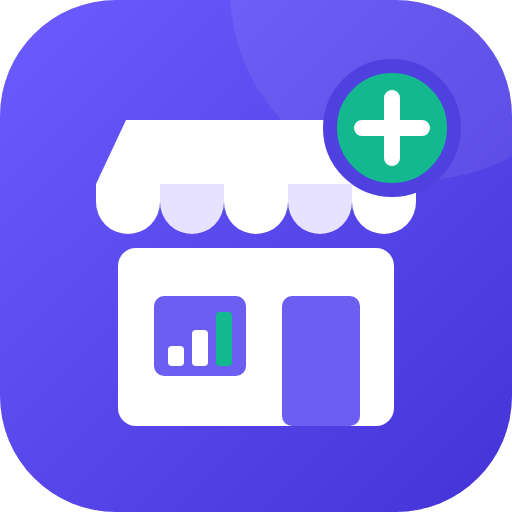
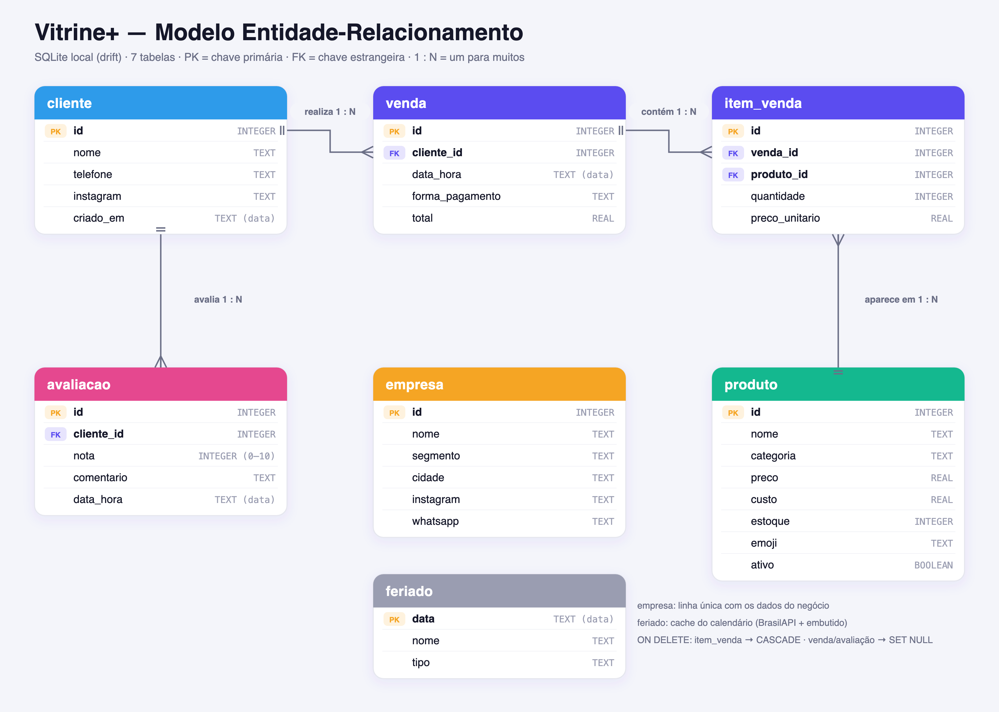
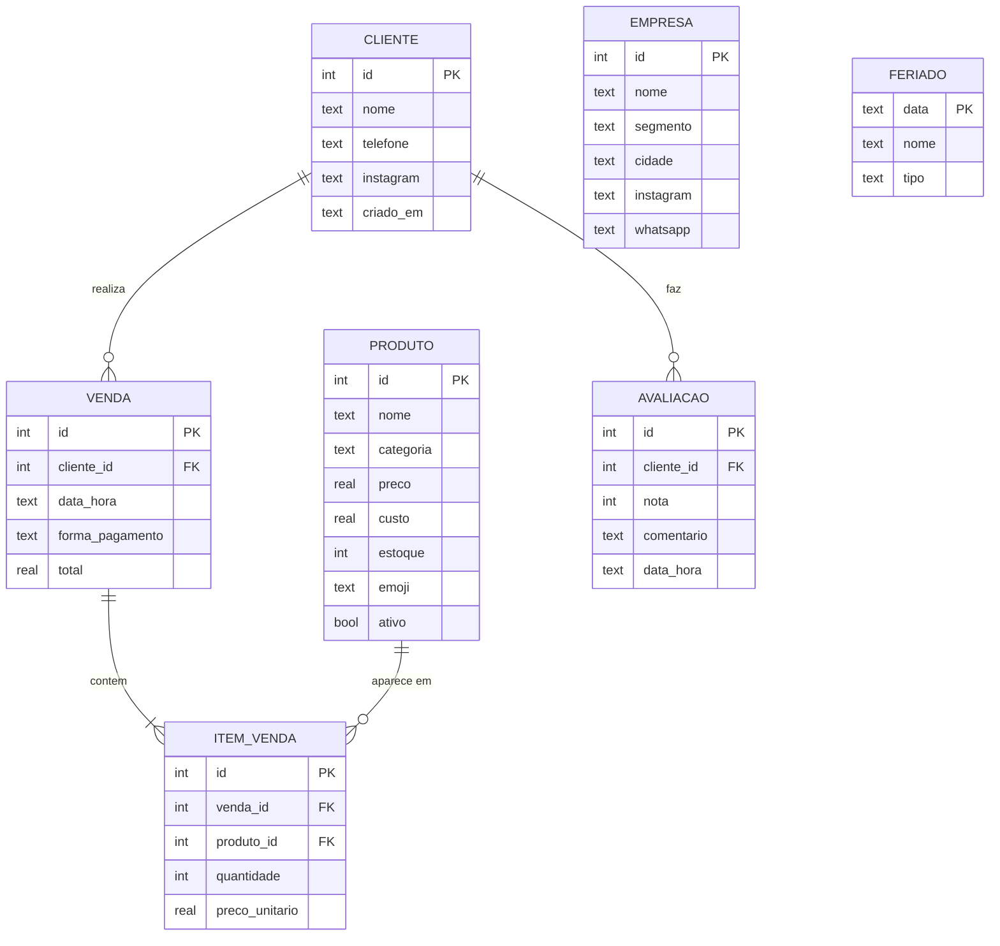
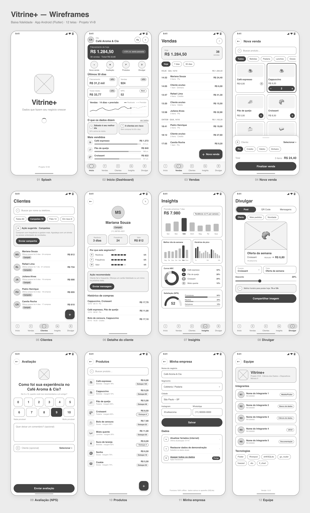
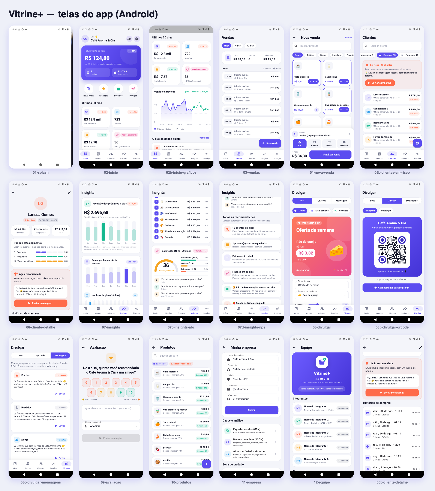
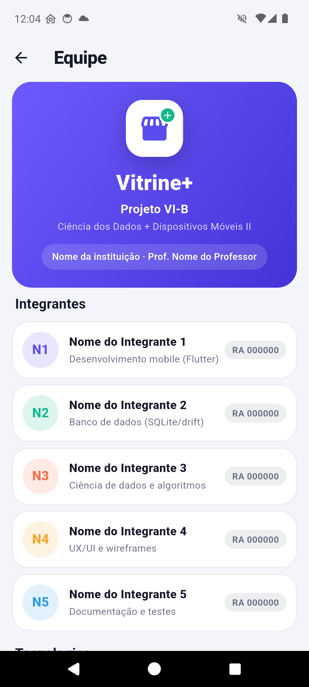
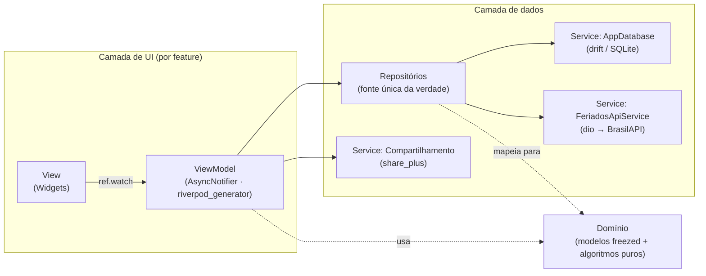

<p align="center">
  
</p>

<h1 align="center">Vitrine+</h1>

<p align="center">
  <b>Dados que fazem seu negócio crescer.</b><br>
  App Android (Flutter) de presença digital e análise de dados para pequenos negócios. Funciona 100% offline.
</p>

<p align="center">
  <b>Projeto VI-B</b> · Ciência dos Dados + Dispositivos Móveis II
</p>

> **Pergunta-guia:** *“Qual aplicativo de celular pode auxiliar no crescimento e inovação dos negócios?”*
>
> **Nossa resposta:** um app que transforma o dia a dia do balcão em **dados**, os dados em **decisões** e as decisões em **ações de divulgação**, tudo no celular do lojista, sem depender de internet.

---

## Sumário

1. [Nome do projeto](#1-nome-do-projeto)
2. [Problema e solução](#2-problema-e-solução)
3. [Público-alvo](#3-público-alvo)
4. [Funcionalidades](#4-funcionalidades)
5. [Modelo Entidade-Relacionamento](#5-modelo-entidade-relacionamento)
6. [Wireframes (HD)](#6-wireframes-hd)
7. [Layout final (telas do app)](#7-layout-final-telas-do-app)
8. [Tela com os nomes do grupo](#8-tela-com-os-nomes-do-grupo)
9. [Banco de dados local: qual usamos e como implementar](#9-banco-de-dados-local-qual-usamos-e-como-implementar)
10. [Ciência dos Dados no app](#10-ciência-dos-dados-no-app)
11. [Arquitetura](#11-arquitetura)
12. [Tecnologias (com links)](#12-tecnologias-com-links)
13. [Como rodar e testar](#13-como-rodar-e-testar)
14. [Como gerar o APK](#14-como-gerar-o-apk)
15. [Estrutura de pastas](#15-estrutura-de-pastas)

---

## 1. Nome do projeto

**Vitrine+**: a “vitrine” é a presença digital do negócio e o “+” representa crescimento, que vem da análise de dados.

| | |
|---|---|
| Plataforma | Android (código Flutter multiplataforma) |
| Pacote | `br.edu.vitrineplus.vitrine_plus` |
| Versão | 1.0.0 |
| Banco local | SQLite (via drift) |
| Internet | Opcional (só para atualizar o calendário de feriados) |

## 2. Problema e solução

### Problema
Pequenos negócios (cafeterias, padarias, salões, lojas de bairro) **vendem todos os dias, mas não usam os dados que produzem**:

- as vendas ficam no caderno, na maquininha ou em planilhas soltas, sem nenhuma análise;
- o dono não sabe **qual produto realmente dá lucro**, **qual é o melhor dia e horário** nem **quais clientes deixaram de vir**;
- a divulgação nas redes é feita “no feeling”, sem saber **o que** destacar nem **quando** postar;
- ferramentas de BI e CRM são caras, complexas e exigem internet e computador.

### Solução
O **Vitrine+** é um app de celular que:

1. **Registra** vendas, produtos, clientes e avaliações em um **banco SQLite local** (funciona offline);
2. **Analisa** os dados no próprio aparelho com técnicas de Ciência dos Dados: **curva ABC**, **segmentação RFM**, **previsão de vendas** (sazonalidade + regressão linear), **NPS**, horários de pico e sazonalidade semanal;
3. **Recomenda** ações em linguagem simples, como “Sábado é seu melhor dia”, “13 clientes em risco” ou “Açaí em alta”;
4. **Divulga** com um clique: gera **posts prontos** (imagem 1:1), **QR Code** para o balcão e **mensagens personalizadas por segmento** de cliente para WhatsApp/Instagram, e ainda sugere o **melhor horário para postar**.

**Ciclo de valor:** vender → registrar → analisar → agir (divulgar) → vender mais.

## 3. Público-alvo

| Perfil | Necessidade |
|---|---|
| **Microempreendedores e MEIs** do comércio e de serviços (cafeterias, padarias, lanchonetes, lojas de roupa, salões, pet shops) | Controlar vendas e entender o negócio sem planilhas |
| Donos que **atendem no balcão e fazem a própria divulgação** | Saber o que postar, quando postar e para quem mandar mensagem |
| Negócios em locais com **internet instável** | App que funciona totalmente offline |
| Faixa etária ampla, com pouca familiaridade com tecnologia | Interface simples, botões grandes, linguagem sem jargão |

**Persona:** *Ana, 38 anos, dona do “Café Aroma & Cia”.* Atende no balcão, posta no Instagram quando sobra tempo e quer saber por que algumas semanas vendem menos.

## 4. Funcionalidades

| Módulo | O que faz |
|---|---|
| **Início (Dashboard)** | Faturamento de hoje × mesmo dia da semana passada (até o mesmo horário), KPIs dos últimos 30 dias (faturamento, vendas, ticket médio, NPS) com variação, gráfico das vendas de 14 dias + **previsão de 7 dias**, principais recomendações e ranking dos mais vendidos |
| **Vendas** | Lista agrupada por dia (Hoje / 7 dias / 30 dias), detalhes com itens, exclusão que **devolve ao estoque** |
| **Nova venda** | Catálogo com busca e filtro por categoria, carrinho com +/–, cliente identificado ou avulso (com cadastro rápido), forma de pagamento (Pix, crédito, débito, dinheiro), baixa automática de estoque |
| **Clientes (RFM)** | Segmentação automática em *Campeões, Fiéis, Novos, Promissores, Em risco, Perdidos*, ação sugerida e **campanha em 1 toque** para o segmento |
| **Detalhe do cliente** | Recência, frequência e valor, notas R/F/M (1–5), explicação do segmento, mensagem personalizada e histórico de compras |
| **Insights** | Previsão da semana (com tendência e erro do modelo), desempenho por dia da semana, horários de pico, **curva ABC** (rosca + lista), **NPS** (velocímetro + comentários) e todas as recomendações |
| **Divulgar** | **Gerador de post** (Oferta / Mais pedidos / Novidade, com desconto e produto em destaque), exportado em PNG para Instagram/WhatsApp; **QR Code** para Instagram/WhatsApp; **mensagens prontas** por segmento; melhor horário para postar; próximas datas comemorativas |
| **Avaliação (NPS)** | Tela para o cliente responder no balcão (nota de 0 a 10 + comentário) |
| **Produtos** | Cadastro com ícone (emoji), categoria, preço, custo, **margem** e alerta de **estoque baixo** |
| **Minha empresa** | Dados do negócio, **exportar CSV** (para análise em Python/Excel), **backup JSON**, atualizar feriados (internet opcional), restaurar dados de demonstração, apagar tudo |
| **Equipe** | Tela com os nomes do grupo, disciplinas e tecnologias |

> **Dados de demonstração:** na primeira execução o app gera **6 meses de vendas fictícias** (cerca de 4.000 vendas, 17 produtos, 60 clientes e 170 avaliações) de uma cafeteria. Os dados já trazem padrões para as análises encontrarem: sábado forte, segunda fraca, picos às 8h e às 16h, produtos de verão em alta e clientes que sumiram. Para usar com dados reais, basta tocar em **Minha empresa › Apagar todos os dados**.

## 5. Modelo Entidade-Relacionamento



São **7 tabelas** (o requisito era ≥ 4), todas com **≥ 3 colunas** e **4 relacionamentos 1:N** (o requisito era ≥ 2).



| Tabela | Descrição | Relacionamentos |
|---|---|---|
| `cliente` | Clientes identificados do negócio | 1 cliente → N vendas; 1 cliente → N avaliações |
| `venda` | Cabeçalho da venda (data/hora, pagamento, total) | N vendas → 1 cliente (opcional: venda avulsa); 1 venda → N itens |
| `item_venda` | Itens de cada venda (tabela associativa venda × produto) | N itens → 1 venda (**ON DELETE CASCADE**); N itens → 1 produto |
| `produto` | Catálogo com preço, custo e estoque | 1 produto → N itens de venda |
| `avaliacao` | Respostas NPS (nota 0–10 e comentário) | N avaliações → 1 cliente (opcional) |
| `empresa` | Dados do negócio (linha única) | (sem relacionamentos) |
| `feriado` | Cache do calendário (BrasilAPI + calendário embutido) | (sem relacionamentos) |

<details>
<summary><b>DDL gerado pelo drift (SQLite)</b></summary>

```sql
CREATE TABLE "cliente" ("id" INTEGER NOT NULL PRIMARY KEY AUTOINCREMENT, "nome" TEXT NOT NULL,
  "telefone" TEXT NOT NULL DEFAULT '', "instagram" TEXT NOT NULL DEFAULT '', "criado_em" TEXT NOT NULL);

CREATE TABLE "produto" ("id" INTEGER NOT NULL PRIMARY KEY AUTOINCREMENT, "nome" TEXT NOT NULL,
  "categoria" TEXT NOT NULL, "preco" REAL NOT NULL CHECK("preco" >= 0.0), "custo" REAL NOT NULL DEFAULT 0.0,
  "estoque" INTEGER NOT NULL DEFAULT 0, "emoji" TEXT NOT NULL DEFAULT '📦',
  "ativo" INTEGER NOT NULL DEFAULT 1 CHECK ("ativo" IN (0, 1)));

CREATE TABLE "venda" ("id" INTEGER NOT NULL PRIMARY KEY AUTOINCREMENT,
  "cliente_id" INTEGER NULL REFERENCES cliente (id) ON DELETE SET NULL,
  "data_hora" TEXT NOT NULL, "forma_pagamento" TEXT NOT NULL, "total" REAL NOT NULL);

CREATE TABLE "item_venda" ("id" INTEGER NOT NULL PRIMARY KEY AUTOINCREMENT,
  "venda_id" INTEGER NOT NULL REFERENCES venda (id) ON DELETE CASCADE,
  "produto_id" INTEGER NOT NULL REFERENCES produto (id),
  "quantidade" INTEGER NOT NULL CHECK("quantidade" > 0), "preco_unitario" REAL NOT NULL);

CREATE TABLE "avaliacao" ("id" INTEGER NOT NULL PRIMARY KEY AUTOINCREMENT,
  "cliente_id" INTEGER NULL REFERENCES cliente (id) ON DELETE SET NULL,
  "nota" INTEGER NOT NULL CHECK("nota" BETWEEN 0 AND 10), "comentario" TEXT NOT NULL DEFAULT '',
  "data_hora" TEXT NOT NULL);

CREATE TABLE "empresa" ("id" INTEGER NOT NULL, "nome" TEXT NOT NULL, "segmento" TEXT NOT NULL,
  "cidade" TEXT NOT NULL DEFAULT '', "instagram" TEXT NOT NULL DEFAULT '',
  "whatsapp" TEXT NOT NULL DEFAULT '', PRIMARY KEY ("id"));

CREATE TABLE "feriado" ("data" TEXT NOT NULL, "nome" TEXT NOT NULL,
  "tipo" TEXT NOT NULL DEFAULT 'national', PRIMARY KEY ("data"));

CREATE INDEX idx_venda_data    ON venda (data_hora);
CREATE INDEX idx_venda_cliente ON venda (cliente_id);
CREATE INDEX idx_item_venda    ON item_venda (venda_id);
```
</details>

O diagrama editável está em [`docs/modelo-er.html`](docs/modelo-er.html) (abra no navegador).

## 6. Wireframes (HD)

Wireframes de baixa fidelidade das 12 telas, em **1170 × 2532 px** cada (a visão geral tem 3640 × 6018 px). O arquivo-fonte editável é [`docs/wireframes/wireframes.html`](docs/wireframes/wireframes.html).



| | | | |
|---|---|---|---|
| [01 Splash](docs/wireframes/01-splash.png) | [02 Início](docs/wireframes/02-inicio.png) | [03 Vendas](docs/wireframes/03-vendas.png) | [04 Nova venda](docs/wireframes/04-nova-venda.png) |
| [05 Clientes](docs/wireframes/05-clientes.png) | [06 Detalhe do cliente](docs/wireframes/06-cliente-detalhe.png) | [07 Insights](docs/wireframes/07-insights.png) | [08 Divulgar](docs/wireframes/08-divulgar.png) |
| [09 Avaliação](docs/wireframes/09-avaliacao.png) | [10 Produtos](docs/wireframes/10-produtos.png) | [11 Minha empresa](docs/wireframes/11-empresa.png) | [12 Equipe](docs/wireframes/12-equipe.png) |

Para regerar um PNG depois de editar o HTML:

```bash
"/Applications/Google Chrome.app/Contents/MacOS/Google Chrome" --headless=new --hide-scrollbars --force-device-scale-factor=3 --window-size=390,844 --screenshot=docs/wireframes/02-inicio.png "file://$PWD/docs/wireframes/wireframes.html?screen=02"
```

## 7. Layout final (telas do app)

Capturas reais do app rodando em um emulador Android (1080 × 2400). Todas estão em [`docs/screenshots/`](docs/screenshots).



**Identidade visual**

| Token | Cor | Uso |
|---|---|---|
| `primary` | `#5B4CF0` | Marca, botões, destaques |
| `mint` | `#14B88F` | Crescimento, previsão, positivo |
| `coral` | `#FF6B4A` | Alertas, queda, “em risco” |
| `amber` | `#F5A524` | Avisos, ticket médio |
| `sky` | `#2E9BEA` | Horários, informações |
| `ink` / `bg` | `#151729` / `#F4F5FA` | Texto e fundo |

Material 3, cantos bem arredondados (22 px nos cards), tipografia pesada nos números e ícones arredondados. O ícone do app está em [`docs/marca/`](docs/marca).

## 8. Tela com os nomes do grupo

Acesso: **Início › ícone 👥 (canto superior direito)**.



Para colocar os nomes reais, edite **um único arquivo**,
[`app/lib/features/equipe/domain/equipe.dart`](app/lib/features/equipe/domain/equipe.dart):

```dart
const instituicao = 'Nome da instituição';
const professor = 'Prof. Nome do Professor';

const integrantes = [
  Integrante('Nome do Integrante 1', 'RA 000000', 'Desenvolvimento mobile (Flutter)'),
  Integrante('Nome do Integrante 2', 'RA 000000', 'Banco de dados (SQLite/drift)'),
  // ...
];
```

## 9. Banco de dados local: qual usamos e como implementar

### Qual banco?
**SQLite**, acessado pelo **[drift](https://drift.simonbinder.eu)**, um ORM *tipado* para Dart/Flutter. O arquivo `vitrine_plus.sqlite` fica na pasta privada do app no aparelho, então **nada depende de internet**.

**Por que drift, e não `sqflite` puro?**

| | sqflite | **drift** |
|---|---|---|
| Esquema | SQL em strings | Tabelas declaradas em Dart, **validadas na compilação** |
| Consultas | `Map<String, dynamic>` | Classes tipadas geradas, sem *casts* |
| SQL “cru” | Sim | **Sim também** (`customSelect`): usamos para os `GROUP BY` analíticos |
| Reatividade | Manual | `tableUpdates()` / `watch()`: a tela atualiza sozinha após cada escrita |
| Migrações | Manuais | `MigrationStrategy` com `schemaVersion` |
| Transações | Sim | Sim (`transaction`) |

### Como implementar (passo a passo)

**1) Dependências** (`pubspec.yaml`):

```yaml
dependencies:
  drift: ^2.31.0
  drift_flutter: ^0.2.8      # abre o SQLite no Android/iOS/desktop
dev_dependencies:
  drift_dev: 2.31.0          # gerador de código
  build_runner: ^2.12.0
```

**2) Gravar datas como texto ISO-8601** (`build.yaml`), o que permite agrupar por dia e hora direto no SQL:

```yaml
targets:
  $default:
    builders:
      drift_dev:
        options:
          store_date_time_values_as_text: true
```

**3) Declarar as tabelas** ([`core/database/tables.dart`](app/lib/core/database/tables.dart)):

```dart
@DataClassName('VendaRow')
@TableIndex(name: 'idx_venda_data', columns: {#dataHora})
class Vendas extends Table {
  @override
  String get tableName => 'venda';

  IntColumn get id => integer().autoIncrement()();
  IntColumn get clienteId => integer()
      .nullable()
      .references(Clientes, #id, onDelete: KeyAction.setNull)();   // FK
  DateTimeColumn get dataHora => dateTime()();
  TextColumn get formaPagamento => text()();
  RealColumn get total => real()();
}
```

**4) Criar a classe do banco** ([`core/database/app_database.dart`](app/lib/core/database/app_database.dart)):

```dart
@DriftDatabase(tables: [Empresas, Produtos, Clientes, Vendas, ItensVenda, Avaliacoes, Feriados])
class AppDatabase extends _$AppDatabase {
  AppDatabase([QueryExecutor? e]) : super(e ?? driftDatabase(name: 'vitrine_plus'));

  @override
  int get schemaVersion => 1;

  @override
  MigrationStrategy get migration => MigrationStrategy(
        onCreate: (m) => m.createAll(),
        beforeOpen: (_) => customStatement('PRAGMA foreign_keys = ON'),
      );
}
```

**5) Gerar o código:** `dart run build_runner build`.

**6) Injetar com Riverpod** ([`database_providers.dart`](app/lib/core/database/database_providers.dart)):

```dart
@Riverpod(keepAlive: true)
AppDatabase appDatabase(Ref ref) {
  final db = AppDatabase();
  ref.onDispose(db.close);
  return db;
}

/// Muda a cada escrita no banco → os ViewModels que a observam recalculam sozinhos.
@Riverpod(keepAlive: true)
Stream<int> dbRevision(Ref ref) {
  var rev = 0;
  return ref.watch(appDatabaseProvider).tableUpdates().map((_) => ++rev);
}
```

**7) Usar nos repositórios.** Transação para gravar a venda e baixar o estoque ([`vendas_repository.dart`](app/lib/features/vendas/data/vendas_repository.dart)):

```dart
return _db.transaction(() async {
  final id = await _db.into(_db.vendas).insert(VendasCompanion.insert(
    clienteId: Value(clienteId), dataHora: DateTime.now(),
    formaPagamento: formaPagamento, total: total));
  for (final i in itens) {
    await _db.into(_db.itensVenda).insert(ItensVendaCompanion.insert(
      vendaId: id, produtoId: i.produtoId, quantidade: i.quantidade, precoUnitario: i.precoUnitario));
    await _db.customUpdate('UPDATE produto SET estoque = MAX(estoque - ?, 0) WHERE id = ?',
      variables: [Variable.withInt(i.quantidade), Variable.withInt(i.produtoId)], updates: {_db.produtos});
  }
  return id;
});
```

Consulta analítica com SQL “cru” ([`analytics_repository.dart`](app/lib/features/insights/data/analytics_repository.dart)):

```sql
SELECT substr(data_hora, 1, 10) AS dia, SUM(total) AS receita, COUNT(*) AS vendas
  FROM venda
 WHERE data_hora >= ? AND data_hora < ?
 GROUP BY dia
```

**8) Testar com banco em memória** ([`test/banco_test.dart`](app/test/banco_test.dart)):

```dart
final db = AppDatabase(DatabaseConnection(NativeDatabase.memory()));
```

## 10. Ciência dos Dados no app

Todos os algoritmos são **funções Dart puras** (sem dependência de banco ou de tela), cobertas por testes unitários em [`test/algoritmos_test.dart`](app/test/algoritmos_test.dart).

| Técnica | Pergunta de negócio | Como funciona | Código |
|---|---|---|---|
| **Curva ABC (Pareto)** | Quais produtos sustentam o faturamento? | Ordena por receita (90 dias) e acumula %: **A** até 80%, **B** até 95%, **C** no restante | [`curva_abc.dart`](app/lib/features/insights/domain/curva_abc.dart) |
| **Segmentação RFM** | Quem são meus melhores clientes e quem está indo embora? | **R**ecência em faixas de dias (≤7, ≤15, ≤30, ≤60), **F**requência e **M**onetário por **quintis** → notas de 1 a 5 → 6 segmentos por regras | [`rfm.dart`](app/lib/features/clientes/domain/rfm.dart) |
| **Previsão de vendas** | Quanto vou vender na próxima semana? | **Decomposição sazonal** (índice por dia da semana) + **regressão linear (MQO)** nas últimas 4 semanas dessazonalizadas. Feriados recebem o índice de domingo. **Backtest** nos 7 dias finais mostra o erro (WAPE) | [`previsao.dart`](app/lib/features/insights/domain/previsao.dart) |
| **NPS** | Meus clientes estão satisfeitos? | % promotores (9–10) − % detratores (0–6), com as zonas oficiais | [`nps.dart`](app/lib/features/avaliacoes/domain/nps.dart) |
| **Sazonalidade e picos** | Qual o melhor dia e horário? | `GROUP BY` por hora e índice por dia da semana | [`analytics_repository.dart`](app/lib/features/insights/data/analytics_repository.dart) |
| **Variação de produtos** | O que está em alta ou em queda? | Receita dos últimos 28 dias × 28 anteriores | [`insights_engine.dart`](app/lib/features/insights/domain/insights_engine.dart) |
| **Motor de recomendações** | O que eu faço agora? | Regras priorizadas que transformam os números em frases e ações | [`insights_engine.dart`](app/lib/features/insights/domain/insights_engine.dart) |

**Exportação para análise externa:** em *Minha empresa › Exportar vendas (CSV)* o app gera um CSV no formato *tidy* (uma linha por item vendido), pronto para o pandas:

```python
import pandas as pd
df = pd.read_csv("vitrine_vendas.csv", parse_dates=["data_hora"])
df.groupby("dia_semana")["subtotal"].sum()          # 1=segunda ... 7=domingo
df.groupby("produto")["subtotal"].sum().sort_values(ascending=False).cumsum()  # curva ABC
```

Colunas: `venda_id, data_hora, dia_semana, hora, cliente, forma_pagamento, produto, categoria, quantidade, preco_unitario, subtotal, custo`.

## 11. Arquitetura

Seguimos o **[guia oficial de arquitetura do Flutter](https://docs.flutter.dev/app-architecture/guide)** (MVVM com camadas de **UI**, **Repositórios** e **Services**), organizado **por funcionalidade**.



| Decisão | Escolha |
|---|---|
| Arquitetura | MVVM do guia oficial: UI (View + ViewModel) → Repositórios → Services |
| Organização | Por feature (`features/vendas`, `features/clientes`, ...), cada uma com `data/`, `domain/` e `ui/` |
| Estado | **Riverpod 3** com **riverpod_generator** e **AsyncNotifier** |
| Navegação | **go_router** (`StatefulShellRoute` para as 5 abas) |
| Injeção de dependência | O próprio Riverpod (providers), sem get_it |
| Modelos e imutabilidade | **freezed** + **json_serializable** (usado no backup JSON) |
| Rede | **dio**, apenas para a BrasilAPI de feriados (opcional, com cache local) |
| Persistência | **drift** (SQLite tipado) |
| Reatividade | `dbRevisionProvider` (stream de `tableUpdates()` do drift): qualquer escrita no banco recalcula as telas |

**Offline-first:** o banco local é a única fonte de verdade. A internet só *atualiza* o cache de feriados. Sem rede, o app usa o calendário embutido (feriados nacionais calculados, incluindo Páscoa, Carnaval e Corpus Christi, mais datas comerciais como Dia das Mães e Black Friday).

## 12. Tecnologias (com links)

| Tecnologia | Versão | Para quê |
|---|---|---|
| [Flutter](https://flutter.dev) | 3.41 | Framework de UI multiplataforma |
| [Dart](https://dart.dev) | 3.11 | Linguagem |
| [SQLite](https://www.sqlite.org) | 3 | Banco de dados local |
| [drift](https://pub.dev/packages/drift) · [docs](https://drift.simonbinder.eu) | 2.31 | ORM tipado para SQLite |
| [drift_flutter](https://pub.dev/packages/drift_flutter) | 0.2.8 | Abre o SQLite no Android |
| [flutter_riverpod](https://pub.dev/packages/flutter_riverpod) · [docs](https://riverpod.dev) | 3.3 | Estado e injeção de dependência |
| [riverpod_generator](https://pub.dev/packages/riverpod_generator) | 4.0 | Geração de providers e AsyncNotifier |
| [go_router](https://pub.dev/packages/go_router) | 17.5 | Navegação declarativa |
| [freezed](https://pub.dev/packages/freezed) | 3.2 | Modelos imutáveis |
| [json_serializable](https://pub.dev/packages/json_serializable) | 6.13 | Serialização JSON |
| [dio](https://pub.dev/packages/dio) | 5.11 | Cliente HTTP |
| [fl_chart](https://pub.dev/packages/fl_chart) | 1.2 | Gráficos (linha, barras, rosca) |
| [qr_flutter](https://pub.dev/packages/qr_flutter) | 4.1 | Geração de QR Code |
| [share_plus](https://pub.dev/packages/share_plus) | 13.3 | Compartilhar no WhatsApp/Instagram |
| [intl](https://pub.dev/packages/intl) | 0.20 | Moeda (R$) e datas em pt-BR |
| [build_runner](https://pub.dev/packages/build_runner) | 2.15 | Geração de código |
| [BrasilAPI — Feriados](https://brasilapi.com.br/docs#tag/Feriados-Nacionais) | v1 | Calendário de feriados (opcional) |
| [Android Studio](https://developer.android.com/studio) / Android SDK | API 36 | Build e emulador |
| [FVM](https://fvm.app) (opcional) | — | Fixar a versão do Flutter |

## 13. Como rodar e testar

Pré-requisitos: [Flutter SDK](https://docs.flutter.dev/get-started/install) 3.41+ e Android SDK (via Android Studio).

```bash
cd app
flutter pub get
dart run build_runner build      # gera *.g.dart e *.freezed.dart
flutter test                     # 15 testes: algoritmos + banco em memória
flutter run                      # com um emulador ou celular conectado
```

> Quando alterar tabelas, modelos ou providers, rode `dart run build_runner build` de novo (ou `dart run build_runner watch` durante o desenvolvimento).

## 14. Como gerar o APK

### APK para instalar e testar (rápido)

```bash
cd app
flutter build apk --release
```

O arquivo sai em `app/build/app/outputs/flutter-apk/app-release.apk` (cerca de 63 MB, com todas as arquiteturas).

**APKs menores, um por arquitetura** (o `arm64-v8a` serve para quase todos os celulares atuais):

```bash
flutter build apk --release --split-per-abi
```

**Instalar no celular:**
1. Ative *Opções do desenvolvedor › Depuração USB* e conecte o cabo, então rode `flutter install`, **ou**
2. Copie o `.apk` para o celular e abra-o (permita “instalar apps de fontes desconhecidas”).

Uma cópia do APK já gerado fica em `entrega/vitrine-plus-1.0.0.apk`. Ela é ignorada pelo git, então publique-a em **GitHub › Releases**.

### APK/AAB assinado (para publicar na Play Store)

1. Gere uma chave (uma única vez):
   ```bash
   keytool -genkey -v -keystore ~/vitrine-upload.jks -keyalg RSA -keysize 2048 -validity 10000 -alias upload
   ```
2. Crie `app/android/key.properties` (**não versionar**):
   ```properties
   storePassword=SUA_SENHA
   keyPassword=SUA_SENHA
   keyAlias=upload
   storeFile=/caminho/para/vitrine-upload.jks
   ```
3. Em `app/android/app/build.gradle.kts`, leia o `key.properties` e configure `signingConfigs.release` (veja o [guia oficial de publicação Android](https://docs.flutter.dev/deployment/android#sign-the-app)).
4. Gere o pacote para a loja:
   ```bash
   flutter build appbundle --release
   ```

> Sem a etapa de assinatura, o `flutter build apk --release` assina com a chave de *debug*. Isso basta para instalar e apresentar, mas não para publicar na Play Store.

## 15. Estrutura de pastas

```
Projeto VI-B/
├── README.md                  ← este documento
├── docs/
│   ├── modelo-er.png / .html  ← diagrama ER (HD + editável)
│   ├── wireframes/            ← 12 wireframes HD + visão geral + fonte HTML
│   ├── screenshots/           ← capturas reais do app
│   ├── galeria-telas.png
│   └── marca/                 ← ícone do app (SVG/PNG)
├── entrega/                   ← APK gerado (fora do git)
└── app/                       ← projeto Flutter
    ├── build.yaml             ← opções do drift/json_serializable
    ├── lib/
    │   ├── main.dart
    │   ├── app/               ← MaterialApp + go_router
    │   ├── core/
    │   │   ├── database/      ← drift: tabelas, AppDatabase, providers, dados demo
    │   │   ├── network/       ← dio
    │   │   ├── services/      ← compartilhamento (share_plus)
    │   │   ├── theme/         ← cores e tema Material 3
    │   │   ├── utils/         ← formatação R$, datas
    │   │   └── widgets/       ← componentes reutilizáveis
    │   └── features/
    │       ├── dashboard/     (ui)
    │       ├── vendas/        (data · domain · ui)
    │       ├── produtos/      (data · domain · ui)
    │       ├── clientes/      (data · domain[RFM] · ui)
    │       ├── insights/      (data[SQL analítico] · domain[ABC, previsão, regras] · ui)
    │       ├── avaliacoes/    (data · domain[NPS] · ui)
    │       ├── divulgar/      (ui: post, QR, mensagens)
    │       ├── feriados/      (data[dio + cache] · domain[calendário])
    │       ├── empresa/       (data · domain · ui[exportações])
    │       ├── equipe/        (domain[nomes do grupo] · ui)
    │       ├── splash/ · shell/
    └── test/
        ├── algoritmos_test.dart
        └── banco_test.dart
```

---

<p align="center"><sub>Vitrine+ · Projeto VI-B · feito com Flutter 💙</sub></p>
